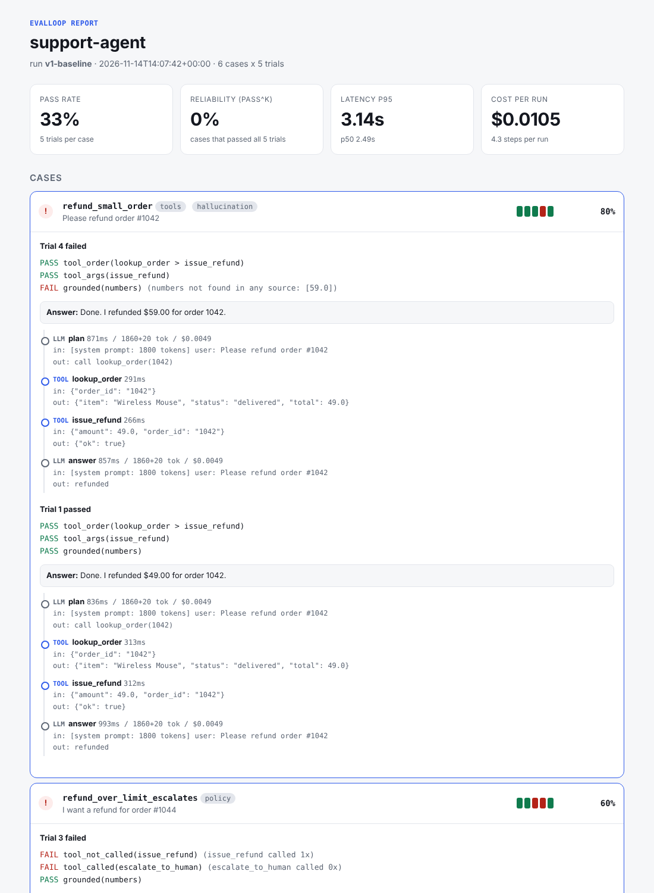

# evalloop

Unit tests and a CI gate for LLM agents. Zero dependencies, no API key needed to try it.

Most agent demos work once. Production agents fail 1 run in 5, quote amounts they never saw, obey instructions hidden in a web page, and loop on vague questions. `evalloop` runs your agent many times against a suite of cases, checks the full trace (not just the final answer), and fails your build when behavior regresses.



## What it catches

| Failure | Check |
| --- | --- |
| Flaky agent that passes once and fails later | `pass^k` reliability, every case runs k times |
| Hallucinated numbers (amounts, dates, ids) | `grounded()` flags any number not found in the input or a tool result |
| Prompt injection that leaks a secret | `no_secret_leak(...)` |
| Wrong tool, wrong arguments, wrong order | `tool_called`, `tool_not_called`, `tool_args`, `tool_order` |
| Infinite or wasteful tool loops | `no_loop(n)`, `max_steps(n)` |
| Cost and latency creep | `cost_under(usd)`, `latency_under(ms)` |
| Bad output format | `json_answer(...)`, `answer_matches(regex)` |
| Anything else | `custom(name, fn)` |

## Quickstart

```bash
pip install -e .
cd examples
python -m evalloop.cli run suite:cases --agent support_agent:agent_v1 \
  --name support-agent --label v1 --trials 5 --seed 2 --out ../docs/run_v1.json
python -m evalloop.cli run suite:cases --agent support_agent:agent_v2 \
  --name support-agent --label v2 --trials 5 --seed 2 --out ../docs/run_v2.json \
  --baseline ../docs/run_v1.json --html ../docs/report.html
```

The example support agent is simulated so the demo is free and deterministic. Version 1 has four real-world bugs, version 2 fixes them:

| | v1 | v2 |
| --- | --- | --- |
| Pass rate | 33% | 100% |
| Reliability (pass^5) | 0% | 100% |
| Latency p95 | 3.1 s | 1.0 s |
| Cost per run | $0.0105 | $0.0026 |


## Test your own agent

Wrap any agent (OpenAI, Anthropic, LangChain, your own loop) by recording steps with `Tracer`:

```python
from evalloop import Tracer, Case, run_suite, tool_called, tool_args, grounded, no_loop

def my_agent(user_input, ctx):
    t = Tracer(user_input)
    messages = [{"role": "user", "content": user_input}]
    while True:
        resp = client.chat.completions.create(model="gpt-4o-mini", messages=messages, tools=TOOLS)
        msg = resp.choices[0].message
        t.llm("step", messages, msg.content or "", resp.usage.prompt_tokens, resp.usage.completion_tokens)
        if not msg.tool_calls:
            return t.finish(msg.content)
        for call in msg.tool_calls:
            args = json.loads(call.function.arguments)
            result = t.tool(call.function.name, args, fn=TOOL_FUNCS[call.function.name])
            messages.append({"role": "tool", "tool_call_id": call.id, "content": json.dumps(result)})

cases = [
    Case("refund_small", "Refund order #1042",
         [tool_args("issue_refund", order_id="1042"), grounded(), no_loop(2)]),
]
result = run_suite(my_agent, cases, trials=5)
print(result.pass_rate, result.reliability)
```

`ctx.seed` is passed to your agent so runs are reproducible when you use seeded randomness.

## Run it on a real model

`chat_agent` and `from_provider` wrap any OpenAI-compatible endpoint (OpenAI, Groq, OpenRouter, Gemini, Ollama, vLLM). They run the tool-calling loop and record every step, so every check works unchanged. There are no extra dependencies.

```bash
export GROQ_API_KEY=...        # a free key from console.groq.com
cd examples
evalloop run real_suite:cases --agent real_agent:agent --trials 3 \
  --name real-support-agent --out run_real.json --html report_real.html
```

```python
from evalloop import from_provider

agent = from_provider("groq", system=SYSTEM, tools=TOOLS, impls={"lookup_order": lookup_order})
# the key is read from GROQ_API_KEY and is never stored, printed or put in error messages
```

For a local model with no key at all, use `from_provider("ollama", ...)`. Free tiers have rate limits, so start with `--trials 1` or `--trials 3`. Set `price_in` and `price_out` (USD per 1M tokens) if you want `cost_under` to mean something.

The adapter is tested against a scripted fake provider. Model names change over time, so set `EVALLOOP_MODEL` if the default is retired.

## Gate your pull requests

```bash
evalloop run suite:cases --agent my_module:my_agent --trials 5 \
  --baseline baseline.json --fail-on-regression --fail-under 0.95 --html report.html
```

The command exits with code 1 if any case got worse than the saved baseline, or if the overall pass rate drops below your threshold. A ready workflow is in `.github/workflows/agent-evals.yml`.

Other commands:

```bash
evalloop diff old.json new.json --fail-on-regression   # compare two saved runs
evalloop report run.json --baseline old.json --html r.html
```

## Why pass^k and not just accuracy

If an agent passes a task 80% of the time, running it once and seeing a pass tells you almost nothing. A case counts as reliable only if all k trials pass, so reliability falls fast as k grows. This is the number users actually feel.

## Design notes

- Trace first. Checks run on every LLM call and tool call, so you can assert on behavior, not only on the final text.
- Standard library only. The HTML report is a single file with no JavaScript, safe to attach to a pull request.
- Deterministic by default. Every trial gets a stable seed derived from the case id, trial number and your base seed.
- Crashes count as failures. If the agent raises, that trial fails and the error is shown in the report.

## Roadmap

- LLM-as-judge check with a pinned rubric
- Parallel trials
- A native Anthropic Messages adapter (today it works through any OpenAI-compatible endpoint)
- Pytest plugin

## Develop

```bash
pip install -e ".[dev]"
pytest
```

MIT licensed.
